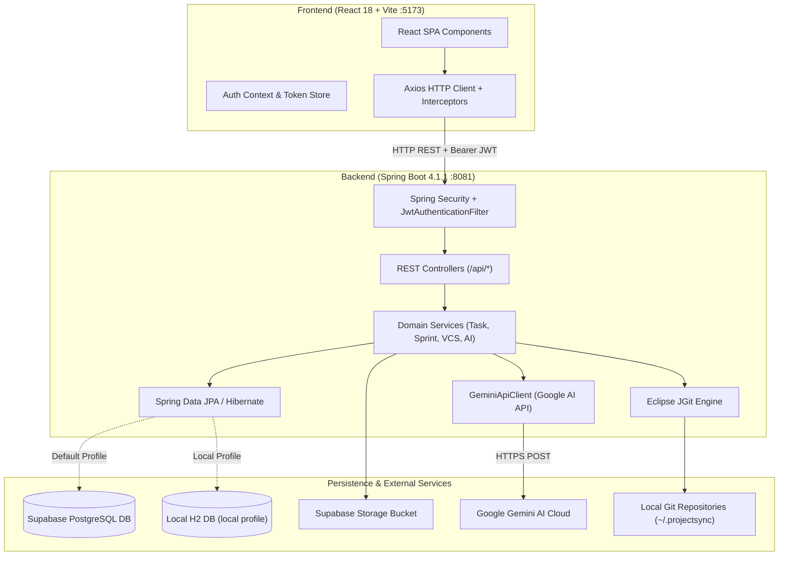

# ProjectSync AI

> An Intelligent Collaborative Software Engineering Platform for Real-Time Project Tracking, Fair Contribution Assessment, and AI-Driven Project Governance.

---

## 1. Project Overview

**ProjectSync AI** is a collaborative software engineering platform designed for university students, faculty evaluators, and academic mentors. It unifies project lifecycle management from initial project proposal drafting, team formation, and Agile sprint execution, to internal Git version control (VCS), automated code quality inspection, standup generation, and rubric-based faculty evaluation into a single ecosystem.

---

## 2. Problem Statement

Traditional academic software engineering projects suffer from major pain points:
- **Unequal Workload & Free-Riding**: In student teams, task distribution and individual contributions are opaque, making fair evaluation difficult.
- **Fragmented Tooling**: Teams juggle separate tools for chat, Git repositories, Kanban boards, and document submission, leading to lost context and fragmented metrics.
- **Delayed Intervention**: Faculty advisors often only review code and progress during end-of-semester milestone reviews, when it is too late to guide struggling teams.
- **Subjective Grading**: Evaluating individual contributions relies on student self-reporting rather than verified Git commits, task history, and code quality audits.

**ProjectSync AI** solves this by providing automated activity tracking, an internal Git engine, Gemini AI-powered sprint breakdown and code inspection, and real-time workload monitoring for faculty.

---

## 3. Main Features & User Roles

### User Roles

| Role | Capabilities | Primary Entry Point |
|---|---|---|
| **STUDENT** | Team formation, project proposal submission, Agile Kanban execution, sprint tracking, Git repository management, peer assessment quizzes, and self-assessment. | `/student/dashboard` |
| **FACULTY** | Project proposal approval/rejection with feedback, live sprint and workload monitoring, automated rubric grading, code quality inspection, risk prediction, and report exporting. | `/faculty/dashboard` |
| **LEADER** (Team Role) | Submits team proposals, manages sprint lifecycles (`PLANNED` -> `ACTIVE` -> `COMPLETED`), and assigns initial tasks. | `/student/projects` |

### Key Features
- **Authentication & Security**: Stateless JWT-based authentication, BCrypt password hashing, and role-based endpoint authorization.
- **Agile Workspace**: Interactive Kanban board (`TODO` -> `IN_PROGRESS` -> `IN_REVIEW` -> `DONE`), task comments, audit logs, and document management.
- **Embedded Git Engine (VCS)**: Pure Java Git implementation powered by Eclipse JGit. Supports repository creation, cloning, staging, un-staging, commits, branch management, diff viewer, and remote sync (`fetch`/`pull`/`push`).
- **Gemini AI Integration**:
  - AI Project Proposal Drafting
  - Automated Sprint Task Breakdown
  - Standup Meeting Summarization
  - Code Quality and Security Inspection
  - Milestone Delay Risk Prediction
  - Rubric-based Automated Evaluation
- **Dual Database Architecture**: Live cloud synchronization with Supabase PostgreSQL or a zero-configuration offline H2 development mode with auto-seeding.

---

## 4. Technology Stack

### Backend
- **Language**: Java 21 (LTS)
- **Framework**: Spring Boot 4.1.1
- **Build Tool**: Apache Maven (via included Maven Wrapper `mvnw.cmd` / `./mvnw`)
- **Security**: Spring Security 6 with JWT (`jjwt-api 0.12.6`)
- **ORM / Persistence**: Spring Data JPA, Hibernate ORM 7.4.x
- **Git VCS Engine**: Eclipse JGit (`7.1.0.202411261347-r`)
- **AI Integration**: Google Gemini Flash API (`generativelanguage.googleapis.com`)
- **Database Drivers**: PostgreSQL JDBC Driver (`42.7.x`), H2 Database Engine

### Frontend
- **Framework**: React 18 (`^18.3.1`)
- **Build Tool / Bundler**: Vite 5 (`^5.4.0`)
- **Routing**: React Router DOM (`^6.26.0`)
- **HTTP Client**: Axios (`^1.7.2`) with automatic JWT authorization interceptors
- **Icons**: Lucide React (`^1.41.0`)
- **Styling**: Modern modular CSS with responsive flexbox and CSS grid layouts

### Storage & External Cloud Services
- **Cloud Database**: Supabase PostgreSQL (AWS `ap-south-1`)
- **File Storage**: Supabase Storage (`project-files` bucket)
- **Local VCS Storage**: Filesystem repository store (`~/.projectsync/repositories`)

---

## 5. System Architecture



---

## 6. Directory Structure

```text
ProjectSync-AI/
├── .env.example                          # Root environment template
├── .gitignore                            # Root Git exclusions
├── CONTRIBUTING.md                       # Team collaboration and PR guidelines
├── README.md                             # Main project manual (this file)
├── docs/                                 # In-depth technical guides
│   ├── API.md                            # Complete REST API reference
│   ├── ARCHITECTURE.md                   # Architecture & data flow diagrams
│   ├── DATABASE_SETUP.md                 # Supabase & H2 database configuration
│   ├── SETUP.md                          # Beginner step-by-step setup guide
│   ├── TROUBLESHOOTING.md                # Error resolutions & diagnostic steps
│   └── VCS_MODULE_GUIDE.md               # Git version control module guide
├── backend/                              # Spring Boot Java application
│   ├── .env.example                      # Backend-specific environment template
│   ├── .mvn/wrapper/                     # Maven wrapper binaries & properties
│   ├── mvnw                              # Linux/macOS Maven wrapper script
│   ├── mvnw.cmd                          # Windows Maven wrapper batch script
│   ├── pom.xml                           # Maven project object model & dependencies
│   └── src/
│       ├── main/
│       │   ├── java/com/projectsync/backend/
│       │   │   ├── BackendApplication.java       # Application entry point
│       │   │   ├── config/                       # DataInitializer & configs
│       │   │   ├── controller/                   # 19 REST controllers
│       │   │   ├── dto/                          # Data transfer objects
│       │   │   ├── entity/                       # JPA database entities
│       │   │   ├── exception/                    # Global exception handler
│       │   │   ├── repository/                   # Spring Data JPA repositories
│       │   │   ├── security/                     # SecurityConfig, JWT filters
│       │   │   ├── service/                      # Business & AI services
│       │   │   └── vcs/                          # JGit engine, DTOs, controllers
│       │   └── resources/
│       │       ├── application.properties        # Main configuration
│       │       ├── application-local.properties  # Standalone offline H2 profile
│       │       └── application-supabase.properties # Production Supabase profile
│       └── test/java/com/projectsync/backend/    # JUnit 5 integration tests
└── frontend/                             # React SPA (Vite)
    ├── index.html                        # HTML entry point
    ├── package.json                      # Node dependencies and scripts
    ├── package-lock.json                 # Locked dependency tree
    ├── vite.config.js                    # Vite dev server & proxy configuration
    └── src/
        ├── App.jsx                       # Client router and route definitions
        ├── main.jsx                      # React DOM mount point
        ├── context/                      # AuthContext and state providers
        ├── layouts/                      # DashboardLayout, Navigation bars
        ├── pages/                        # Student, Faculty, & VCS views
        ├── routes/                       # ProtectedRoute guard
        ├── services/                     # 18 Axios API service modules
        └── styles/                       # CSS stylesheets
```

---

## 7. Prerequisites & Compatible Versions

Verify that your computer has the following tools installed:

| Tool | Minimum Version | Recommended Version | Verification Command |
|---|---|---|---|
| **Java JDK** | 21.0.0 | 21.0.4+ (Temurin / Oracle) | `java -version` |
| **Node.js** | 18.18.0 | 20.x or 22.x LTS | `node -version` |
| **npm** | 9.0.0 | 10.x+ | `npm -version` |
| **Git** | 2.30.0 | 2.40.0+ | `git --version` |

> [!NOTE]
> You do **not** need to install Apache Maven separately. The project includes the Maven Wrapper (`mvnw.cmd`), which downloads and caches the verified Maven version automatically.

---

## 8. Software Installation & Verification

If any prerequisite is missing:

1. **Install Java 21**:
   - Download Eclipse Temurin 21 (LTS) from [Adoptium](https://adoptium.net/temurin/releases/?version=21).
   - Ensure you check the box **"Set JAVA_HOME variable"** and **"Add to PATH"** during installation.
   - Verify in PowerShell:
     ```powershell
     java -version
     ```
2. **Install Node.js & npm**:
   - Download the LTS version from [Nodejs.org](https://nodejs.org/).
   - Verify in PowerShell:
     ```powershell
     node --version
     npm --version
     ```
3. **Install Git**:
   - Download from [git-scm.com](https://git-scm.com/).
   - Verify in PowerShell:
     ```powershell
     git --version
     ```

---

## 9. Clone and Switch to the Correct Branch

Open PowerShell and run:

```powershell
# Clone the team repository
git clone https://github.com/prathamesh8093/ProjectSync-AI.git

# Move into the project directory
cd ProjectSync-AI

# Fetch all remote branches
git fetch --all

# Switch to the project upload branch
git checkout feature/project-upload
```

Confirm that you are on the right branch:
```powershell
git branch
```

---

## 10. Environment Variable Configuration

The project includes template files (`.env.example`) with safe placeholders.

1. Create your local `.env` file from the template:
   ```powershell
   Copy-Item .env.example .env
   ```
2. The available environment variables and their purposes:

| Variable | Description | Default / Example Value | Required? |
|---|---|---|---|
| `SPRING_PROFILES_ACTIVE` | Active profile (`supabase` or `local`) | `local` (offline) or `supabase` | Optional |
| `SUPABASE_DB_URL` | PostgreSQL JDBC connection URL | `jdbc:postgresql://<host>:5432/postgres?sslmode=require` | If using Supabase |
| `SUPABASE_DB_USERNAME` | Database username | `postgres.htwzpyouqnkfnxuvbsot` | If using Supabase |
| `SUPABASE_DB_PASSWORD` | Database user password | Shared team secret | If using Supabase |
| `JWT_SECRET` | Secret key for signing authentication tokens | Min. 32 characters | Optional (has dev default) |
| `GEMINI_API_KEY` | Google Gemini API key | Google AI Studio key | Optional (for AI features) |
| `SUPABASE_SERVICE_ROLE_KEY` | Supabase storage service key | Local dev key or project key | Optional (for file uploads) |
| `PROJECTSYNC_VCS_PATH` | Storage directory for local Git repositories | `~/.projectsync/repositories` | Optional |
| `PROJECTSYNC_VCS_DEV_MODE` | Allow unauthenticated VCS sandbox access | `true` | Optional |

> [!CAUTION]
> **Never commit your `.env` file or hardcode credentials into source code.** Keep `.env` listed in `.gitignore`.

---

## 11. Database Configuration (Two Modes)

ProjectSync AI supports two database modes:

### Mode 1: Offline Local Mode (Recommended for Instant Setup)
If you do not have Supabase credentials, or want to test completely offline:
- Run the backend with `-Dspring-boot.run.profiles=local`.
- The backend will use an embedded H2 database running in PostgreSQL compatibility mode located in `./data/projectsync-local-db`.
- Hibernate automatically creates all 18 tables on boot.
- It automatically seeds test accounts:
  - **Student**: `student@projectsync.local` | Password: `Password123!`
  - **Faculty**: `faculty@projectsync.local` | Password: `Password123!`
- Access the web database console at `http://localhost:8081/h2-console`.

### Mode 2: Shared Supabase Cloud Database (Team Collaborative Mode)
To connect to the team's shared Supabase database:
1. Obtain the `SUPABASE_DB_PASSWORD` from your team coordinator.
2. In PowerShell, set your environment variable or place it in your `.env`:
   ```powershell
   $env:SUPABASE_DB_PASSWORD="your-team-password"
   ```
3. The database URL connects to `aws-0-ap-south-1.pooler.supabase.com:5432` with SSL enabled.

For in-depth database schema details, see [docs/DATABASE_SETUP.md](file:///docs/DATABASE_SETUP.md).

---

## 12. Gemini AI & External Service Configuration

The platform features Gemini AI-assisted capabilities:
- **Obtaining a Key**: You can get a free API key at [Google AI Studio](https://aistudio.google.com/).
- **Configuring the Key**: Set the environment variable:
  ```powershell
  $env:GEMINI_API_KEY="your-gemini-api-key"
  ```
- **Fallback Behavior**: If no API key is supplied, the core application (authentication, Agile Kanban, sprints, tasks, documents, and Git VCS) works normally. AI-assisted buttons (such as "Draft Proposal with AI" or "AI Sprint Breakdown") will return a friendly error prompting you to supply a `GEMINI_API_KEY`.

---

## 13. How to Start the Backend

1. Open PowerShell and navigate to the `backend` directory:
   ```powershell
   cd C:\path\to\ProjectSync-AI\backend
   ```
2. Build and start the backend:
   - **For offline local mode (H2)**:
     ```powershell
     .\mvnw.cmd spring-boot:run -Dspring-boot.run.profiles=local
     ```
   - **For Supabase cloud mode**:
     ```powershell
     $env:SUPABASE_DB_PASSWORD="your-supabase-password"
     .\mvnw.cmd spring-boot:run
     ```
3. **Expected Console Output**:
   ```text
   :: Spring Boot ::                (v4.1.1)
   ...
   Initialized JPA EntityManagerFactory for persistence unit 'default'
   Tomcat started on port 8081 (http) with context path '/'
   Started BackendApplication in 5.234 seconds
   ```
4. **Verify Health**:
   Open a separate PowerShell terminal or your browser:
   ```powershell
   Invoke-RestMethod http://localhost:8081/api/vcs/health
   ```
   Expected response: `{"status":"UP", ...}`

---

## 14. How to Start the Frontend

1. Open a **second** PowerShell window and navigate to the `frontend` directory:
   ```powershell
   cd C:\path\to\ProjectSync-AI\frontend
   ```
2. Install dependencies (first time only):
   ```powershell
   npm install
   ```
3. Start the Vite development server:
   ```powershell
   npm run dev
   ```
4. **Expected Output**:
   ```text
     VITE v5.4.0  ready in 320 ms

     ➜  Local:   http://localhost:5173/
     ➜  Network: use --host to expose
   ```

---

## 15. How to Run the Entire Application Locally

Running the application requires both services active simultaneously:

```text
Terminal 1 (Backend):   http://localhost:8081 (Spring Boot API)
Terminal 2 (Frontend):  http://localhost:5173 (React UI)
```

Open your browser to:
[**http://localhost:5173**](http://localhost:5173)

---

## 16. Verified Ports and Local URLs

| Component | URL | Verified Code Mapping |
|---|---|---|
| **Frontend UI** | `http://localhost:5173` | `frontend/vite.config.js:7` |
| **Backend REST API** | `http://localhost:8081/api` | `backend/src/main/resources/application.properties:20` |
| **VCS Health Probe** | `http://localhost:8081/api/vcs/health` | `backend/src/main/java/.../VcsController.java:46` |
| **H2 Web Console** (local profile) | `http://localhost:8081/h2-console` | `backend/src/main/resources/application-local.properties:14` |

---

## 17. Login, Authentication & Initial Account Setup

### In Local Offline Mode (`-Dspring-boot.run.profiles=local`):
Log in immediately using pre-seeded test accounts:
- **Student**: `student@projectsync.local` / `Password123!`
- **Faculty**: `faculty@projectsync.local` / `Password123!`

### In Supabase Mode:
1. Navigate to `http://localhost:5173/register`.
2. Fill out your Full Name, Email, Password (minimum 6 characters), and Role (`STUDENT` or `FACULTY`).
3. Click **Register**. The system will save your user record and redirect you to `/login`.
4. Log in with your new email and password.

---

## 18. End-to-End Application Smoke Test

Follow these steps to confirm everything is functioning:

1. **Log in as Student**:
   - Access `http://localhost:5173/login`.
   - Log in and verify redirection to `/student/dashboard`.
2. **Team & Proposal Workflow**:
   - Navigate to `/student/team` and create a team (e.g., "Team Alpha").
   - Navigate to `/student/proposal` and submit a project proposal.
3. **Faculty Approval**:
   - Log out and log in as a Faculty user.
   - Navigate to `/faculty/proposals`, view the submitted proposal, and click **Approve**.
4. **Agile Kanban**:
   - Log back in as the student team leader.
   - Go to `/student/projects`. Verify the approved project appears.
   - Create a sprint (e.g., "Sprint 1") and activate it.
   - Create a task, drag it across Kanban columns (`TODO` -> `IN_PROGRESS` -> `DONE`).
5. **VCS Module**:
   - Go to `/student/vcs`.
   - Click **Create Repository** (e.g., `alpha-repo`).
   - Create a file, stage it, and commit with message `Initial commit`.
   - Verify commit history and branches in the VCS dashboard.

---

## 19. How to Run Tests and Production Builds

### Backend Integration Tests
From the `backend` directory:
```powershell
.\mvnw.cmd test
```
*Result*: Runs JUnit 5 test suite with in-memory H2 database. (Passes with 0 failures).

### Frontend Production Build
From the `frontend` directory:
```powershell
npm run build
```
*Result*: Compiles 1,900+ modules and verifies bundling into `dist/` without errors.

---

## 20. Stopping and Restarting

- **To Stop**: Press `Ctrl + C` in both PowerShell terminal windows and enter `Y` when prompted.
- **Resolving Port Conflicts**: If a process is stuck on port 8081 or 5173:
  ```powershell
  # Find PID on port 8081
  Get-NetTCPConnection -LocalPort 8081 -ErrorAction SilentlyContinue | Select-Object OwningProcess

  # Terminate PID (replace <PID> with the actual number)
  Stop-Process -Id <PID> -Force
  ```

---

## 21. Common Troubleshooting Scenarios

| Symptom | Cause | Quick Fix |
|---|---|---|
| `java: command not found` | Java JDK is not on Windows PATH | Install Java 21 Temurin and check "Add to PATH". |
| `Connection refused: localhost:8081` | Backend is not started or still booting | Start backend in Terminal 1 and wait for "Started BackendApplication". |
| `FATAL: password authentication failed` | Missing or invalid Supabase password | Supply `$env:SUPABASE_DB_PASSWORD="..."` or run with `-Dspring-boot.run.profiles=local`. |
| `GEMINI_API_KEY is not configured` | AI feature clicked without key | Set `$env:GEMINI_API_KEY="..."` or test standard non-AI features. |
| Vite: `port 5173 is in use` | Another Vite instance is running | Stop other terminal or Vite will automatically use port 5174. |

For a comprehensive guide covering 15+ error scenarios, see [docs/TROUBLESHOOTING.md](file:///docs/TROUBLESHOOTING.md).

---

## 22. Additional Documentation

- [**docs/SETUP.md**](file:///docs/SETUP.md): Step-by-step setup guide for beginners.
- [**docs/DATABASE_SETUP.md**](file:///docs/DATABASE_SETUP.md): Database schemas, tables, and credentials guide.
- [**docs/ARCHITECTURE.md**](file:///docs/ARCHITECTURE.md): Deep-dive into application architecture, security, and data flow.
- [**docs/API.md**](file:///docs/API.md): Full documentation of all 40+ REST API endpoints.
- [**docs/TROUBLESHOOTING.md**](file:///docs/TROUBLESHOOTING.md): Exhaustive troubleshooting manual.
- [**docs/VCS_MODULE_GUIDE.md**](file:///docs/VCS_MODULE_GUIDE.md): Git VCS engine technical documentation.
- [**CONTRIBUTING.md**](file:///CONTRIBUTING.md): Branching strategy, PR guidelines, and Git conventions.

---

## 23. Team Collaboration

- **Team GitHub Repository**: [https://github.com/prathamesh8093/ProjectSync-AI.git](https://github.com/prathamesh8093/ProjectSync-AI.git)
- **Active Feature Branch**: `feature/project-upload`
- **Default Branch**: `main` (Protected; always submit pull requests for review).
