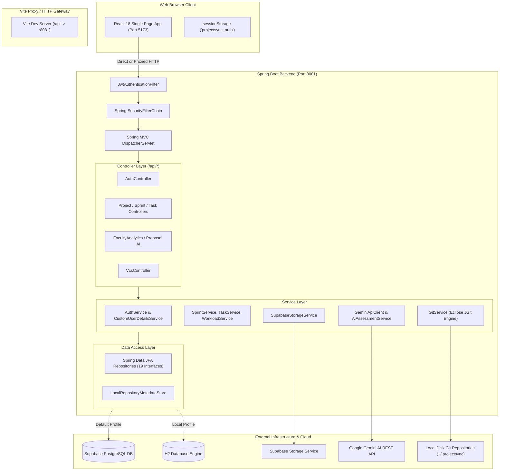
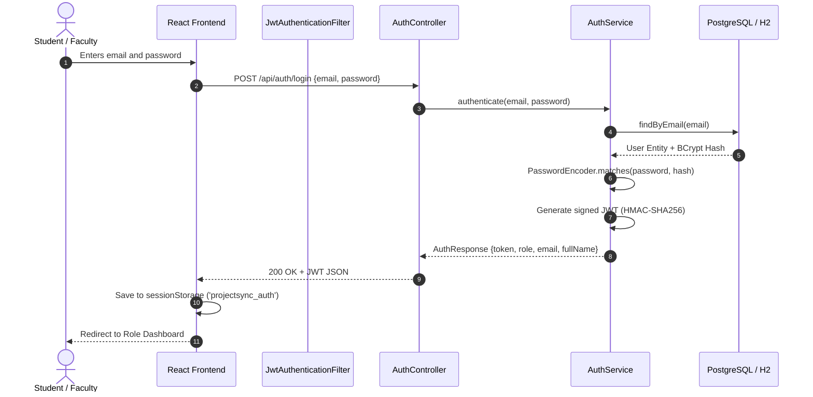
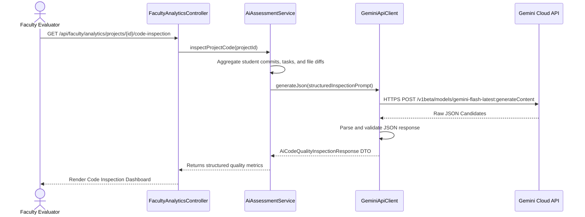

# ProjectSync AI — System Architecture & Design Specification

This document provides a comprehensive technical breakdown of the architecture, security model, data flow, and external integrations in **ProjectSync AI**.

---

## 1. High-Level Architecture Overview

ProjectSync AI is organized as a decoupled, modern multi-tier web application:



---

## 2. Frontend Layer (React 18 + Vite)

### Technology & Structure
- **Vite 5**: Provides fast Hot Module Replacement (HMR) and optimized rollup production bundles.
- **React Router DOM 6**: Handles client-side navigation, history management, and role-guarded routes via `<ProtectedRoute>`.
- **Axios HTTP Client**:
  - Configured with `baseURL: 'http://localhost:8081/api'` in `frontend/src/services/api.js`.
  - **Request Interceptor**: Automatically reads JWT from `sessionStorage` (`projectsync_auth`) and injects the `Authorization: Bearer <token>` header on every outgoing API call.
  - **Response Interceptor**: Catches `401 Unauthorized` responses and automatically clears invalid credentials to prevent stale UI state.
- **Auth Context (`AuthContext.jsx`)**:
  - Exposes `user`, `token`, `login()`, `logout()`, `isAuthenticated`, and helper methods across the React component hierarchy.

### Route Protection Model
The frontend uses route wrappers to restrict access by role:
- **Public**: `/login`, `/register`.
- **Student Only**: `/student/dashboard`, `/student/profile`, `/student/team`, `/student/proposal`, `/student/projects`.
- **Faculty Only**: `/faculty/dashboard`, `/faculty/profile`, `/faculty/proposals`, `/faculty/projects`.
- **Shared / Developer**: `/student/vcs` and `/vcs` (accessible by both roles, with development sandbox fallback).

---

## 3. Backend Layer (Spring Boot 4.1.1)

### Component Layers
1. **Controller Layer**:
   - 19 `@RestController` classes exposed under the `/api` prefix.
   - Responsible for request validation, path parsing, user principal extraction, and standard HTTP response codes (`200 OK`, `201 Created`, `400 Bad Request`, `403 Forbidden`, `404 Not Found`).
2. **Service Layer**:
   - Contains business logic, cross-team authorization rules, team membership validation, and audit logging.
3. **Repository Layer**:
   - 19 interfaces extending `JpaRepository<T, ID>`, providing declarative CRUD and custom JPQL queries.
4. **Exception Handling**:
   - Handled centrally by `GlobalExceptionHandler.java`, ensuring all validation and runtime errors return standardized JSON error objects:
     ```json
     {
       "timestamp": "2026-10-20T16:00:00Z",
       "status": 400,
       "error": "Bad Request",
       "message": "Sprint start date cannot be after end date"
     }
     ```

---

## 4. Security & Authorization Model

### Authentication Flow


### Request Authorization Lifecycle
For every subsequent request:
1. `JwtAuthenticationFilter` intercepts the request.
2. Extracts `Authorization: Bearer <token>` header.
3. Validates signature and expiration against `jwt.secret`.
4. Extracts email and role claim (`STUDENT` or `FACULTY`).
5. Loads user principal and stores `UsernamePasswordAuthenticationToken` in Spring's `SecurityContextHolder`.
6. Service-level checks verify fine-grained permissions:
   - Is this student a member of the requested project's team?
   - Is the user the leader of this team?
   - Is this task assigned to this student?
   - Does this comment belong to the current user?

---

## 5. Embedded Git Engine (Eclipse JGit Integration)

ProjectSync AI features a native Java Git version control engine that does not require an external `git` binary installed on the server:

- **Library**: Eclipse JGit (`org.eclipse.jgit 7.1.0`).
- **Storage Location**: Configurable via `projectsync.vcs.storage-path` (defaults to `~/.projectsync/repositories`).
- **Metadata Management**: `LocalRepositoryMetadataStore.java` records repository metadata, owners, branch information, and initialization state in JSON format on disk.
- **Core Operations**:
  - `init`: Creates new bare or working Git repositories on disk.
  - `clone`: Clones local or remote repositories into isolated project workspaces.
  - `stage` / `unstage`: Manages the JGit Git Index (`dircache`).
  - `commit`: Creates cryptographically signed commits with commit author metadata.
  - `diff`: Uses JGit `DiffFormatter` and `RawTextComparator` to compute unified diffs for code reviews.
  - `sync`: Manages remote refspecs (`fetch`, `pull`, `push`) with configurable remote URLs.
- **Concurrency & Safety**:
  - JGit memory-mapped file cache configured with `WindowCacheConfig.setPackedGitMMAP(false)` to prevent file locking issues on Windows OS.

---

## 6. Gemini AI Architecture

The platform uses Google's Gemini generative AI model to automate administrative and academic workflows:



- **Resilience & Fallback**: If the primary model endpoint (`gemini-flash-latest`) encounters rate limits or errors, `GeminiApiClient` automatically fails over to `gemini-3.5-flash`.
- **Graceful Degradation**: If no `GEMINI_API_KEY` is configured, an informative exception (`GEMINI_API_KEY is not configured`) is handled cleanly without crashing the Spring application context.

---

## 7. Supabase Storage Integration

- **Purpose**: Stores binary project deliverables (ZIP files, PDF design documents, diagrams).
- **Service**: `SupabaseStorageService.java` using Spring's HTTP `RestClient`.
- **Security**: Uploads and downloads are authenticated using the Supabase Service Role Key (`SUPABASE_SERVICE_ROLE_KEY`).
- **Access Control**: Downloads verify project team membership before issuing access.
