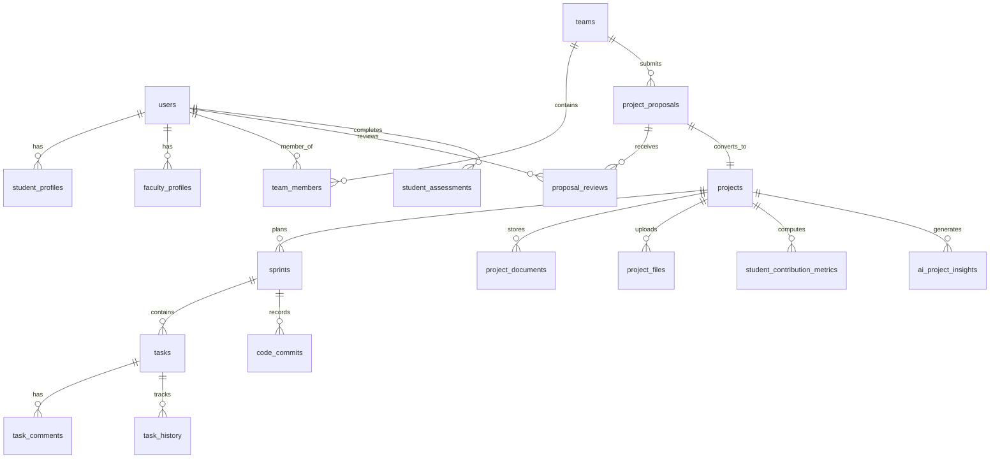

# ProjectSync AI — Database Architecture & Setup Guide

This document describes the database design, configuration modes, schema entities, and safe operational guidelines for **ProjectSync AI**.

---

## 1. Database Architecture Overview

ProjectSync AI uses an Object-Relational Mapping (ORM) architecture powered by **Spring Data JPA** and **Hibernate ORM**. The application supports two distinct operational modes:

1. **Cloud Production / Shared Team Database**:
   - Engine: PostgreSQL 15+ hosted on Supabase (AWS `ap-south-1`).
   - Managed connection pool via HikariCP.
   - Connection routing via Supabase transaction pooler (port `5432` / `6543`).
2. **Local Offline Development Database**:
   - Engine: Embedded H2 Database operating in PostgreSQL compatibility mode.
   - Filesystem persistence: `./data/projectsync-local-db`.
   - Activated via the `local` profile (`-Dspring-boot.run.profiles=local`).

---

## 2. Configuration & Environment Variables

Database configuration is primarily driven by `application.properties` and profile-specific overrides:

```properties
# Primary Supabase Database Properties (in application.properties)
spring.datasource.url=${SUPABASE_DB_URL:jdbc:postgresql://aws-0-ap-south-1.pooler.supabase.com:5432/postgres?sslmode=require&connectTimeout=30&socketTimeout=60}
spring.datasource.driver-class-name=org.postgresql.Driver
spring.datasource.username=${SUPABASE_DB_USERNAME:postgres.htwzpyouqnkfnxuvbsot}
spring.datasource.password=${SUPABASE_DB_PASSWORD:}

# Hikari Connection Pool Settings
spring.datasource.hikari.connection-timeout=30000
spring.datasource.hikari.maximum-pool-size=5
spring.datasource.hikari.minimum-idle=1
spring.datasource.hikari.idle-timeout=30000
spring.datasource.hikari.max-lifetime=45000
spring.datasource.hikari.keepalive-time=15000
spring.datasource.hikari.connection-test-query=SELECT 1

# Hibernate DDL Settings (Production / Shared Database)
spring.jpa.hibernate.ddl-auto=none
spring.jpa.show-sql=false
spring.jpa.database-platform=org.hibernate.dialect.PostgreSQLDialect
```

### Required Environment Variables for Supabase:
When connecting to the shared database, teammates must provide:
- `SUPABASE_DB_PASSWORD`: The secret database password provided by your team coordinator.
- *(Optional)* `SUPABASE_DB_URL`: Override the connection URL if using an individual Supabase instance.
- *(Optional)* `SUPABASE_DB_USERNAME`: Database username if using a custom role.

---

## 3. Hibernate Schema & DDL Behavior

### Production / Default Profile: `spring.jpa.hibernate.ddl-auto=none`
- Hibernate will **never** alter, drop, or create tables automatically when connecting to Supabase.
- This protects team data from accidental table truncation, data loss, or schema corruption during application restarts.

### Local Development Profile: `spring.jpa.hibernate.ddl-auto=update`
- In `application-local.properties`, Hibernate automatically generates and updates tables on application boot.
- If a new entity field is added to the Java code, Hibernate issues `ALTER TABLE ADD COLUMN` automatically.

---

## 4. Database Entities & Tables (18 Tables)

ProjectSync AI organizes its data into 18 mapped relational tables:



### Table Reference

| Table Name | Entity Class | Purpose | Primary Keys & Foreign Keys |
|---|---|---|---|
| `users` | `User` | User accounts, emails, BCrypt password hashes, and roles (`STUDENT`, `FACULTY`). | `id` (PK) |
| `student_profiles` | `StudentProfile` | Student metadata: `student_id`, `department`, `year`, `bio`. | `user_id` (PK, FK -> `users.id`) |
| `faculty_profiles` | `FacultyProfile` | Faculty metadata: `department`, `designation`, `research_areas`. | `user_id` (PK, FK -> `users.id`) |
| `teams` | `Team` | Student project teams and team leader attribution. | `id` (PK), `created_by` (FK -> `users.id`) |
| `team_members` | `TeamMember` | Many-to-many relationship linking students to teams. | `id` (PK), `team_id` (FK), `student_user_id` (FK) |
| `project_proposals` | `ProjectProposal` | Submitted proposals, abstracts, tech stacks, and approval statuses. | `id` (PK), `team_id` (FK), `submitted_by` (FK) |
| `proposal_reviews` | `ProposalReview` | Faculty review comments and decision (`APPROVED`, `REJECTED`, `REVISION_REQUIRED`). | `id` (PK), `proposal_id` (FK), `faculty_user_id` (FK) |
| `projects` | `Project` | Approved active projects, project code (`PRJ-YYYY-XXX`), and status. | `id` (PK), `proposal_id` (FK), `team_id` (FK) |
| `sprints` | `Sprint` | Agile sprints: goals, dates, and statuses (`PLANNED`, `ACTIVE`, `COMPLETED`). | `id` (PK), `project_id` (FK) |
| `tasks` | `Task` | Kanban tasks: title, description, priority, status, and assigned user. | `id` (PK), `sprint_id` (FK), `project_id` (FK), `assigned_to` (FK) |
| `task_comments` | `TaskComment` | Discussion comments on individual tasks. | `id` (PK), `task_id` (FK), `user_id` (FK) |
| `task_history` | `TaskHistory` | Audit trail of task changes (status shifts, reassignments, edits). | `id` (PK), `task_id` (FK), `user_id` (FK) |
| `project_documents` | `ProjectDocument` | Collaborative text documents and specifications. | `id` (PK), `project_id` (FK) |
| `project_files` | `ProjectFile` | Metadata for binary attachments stored in Supabase Storage. | `id` (PK), `project_id` (FK), `uploaded_by` (FK) |
| `student_assessments` | `StudentAssessment` | Student peer reviews and competency quiz scores. | `id` (PK), `student_user_id` (FK), `team_id` (FK) |
| `student_contribution_metrics` | `StudentContributionMetric` | Calculated individual contribution percentages and commit scores. | `id` (PK), `student_user_id` (FK), `project_id` (FK) |
| `ai_project_insights` | `AiProjectInsight` | Gemini AI-generated milestone risk predictions and quality audit scores. | `id` (PK), `project_id` (FK) |
| `code_commits` | `CodeCommit` | Historical commit data linked to sprints for progress analytics. | `id` (PK), `sprint_id` (FK), `user_id` (FK) |

---

## 5. Seed Data & Initialization

### Offline Mode Seeding
When running under `@Profile("local")`, `DataInitializer.java` automatically seeds the database on first boot:
- **Student User**: `student@projectsync.local` (Password: `Password123!`, Role: `STUDENT`)
- **Faculty User**: `faculty@projectsync.local` (Password: `Password123!`, Role: `FACULTY`)
- Password hashes are securely generated with BCrypt on startup.

### Cloud Mode Seeding
In Supabase mode, initial user accounts are created via the application's `/register` endpoint to ensure proper audit timestamps and BCrypt salt rotation.

---

## 6. How to Verify Database Connectivity

### Test 1: Network Ping to Supabase Pooler
Run in PowerShell:
```powershell
Test-NetConnection -ComputerName aws-0-ap-south-1.pooler.supabase.com -Port 5432
```
Expected output: `TcpTestSucceeded : True`

### Test 2: H2 Console Verification (Local Profile)
1. Start backend with `.\mvnw.cmd spring-boot:run -Dspring-boot.run.profiles=local`
2. Open your browser: `http://localhost:8081/h2-console`
3. Enter JDBC URL: `jdbc:h2:file:./data/projectsync-local-db;MODE=PostgreSQL`
4. Leave User Name as `sa` and Password blank. Click **Connect**.
5. Verify you see all 18 tables listed in the left panel.

---

## 7. Common Database Errors & Solutions

### Error 1: `FATAL: password authentication failed for user "postgres..."`
- **Cause**: The `SUPABASE_DB_PASSWORD` environment variable is either unset or incorrect.
- **Solution**: Set `$env:SUPABASE_DB_PASSWORD="your-correct-password"` in PowerShell or switch to offline mode using `-Dspring-boot.run.profiles=local`.

### Error 2: `Connection to ... timed out after 30000 ms`
- **Cause**: Institutional firewalls or campus networks blocking outbound traffic on port `5432`.
- **Solution**:
  1. Use your mobile hotspot or a standard internet connection without restrictive egress port blocking.
  2. Alternatively, run in offline local mode (`-Dspring-boot.run.profiles=local`) which requires zero internet connectivity.

### Error 3: `Table 'users' does not exist`
- **Cause**: Running with `application-supabase.properties` on a clean, empty Supabase project without existing tables.
- **Solution**: Run once with `spring.jpa.hibernate.ddl-auto=update` on your dev branch to initialize tables, then revert to `validate`/`none`.

---

## 8. Safe Collaboration Guidelines

1. **Never commit real credentials**: Do not put passwords in Git. Always use `.env` or system environment variables.
2. **Never drop tables**: Do not execute `DROP TABLE` or `TRUNCATE` commands on the shared Supabase database.
3. **Isolate Test Data**: When creating test teams or projects, prefix names with your initials (e.g., `AS-Test-Project`) so teammates do not mistake them for active grading projects.
